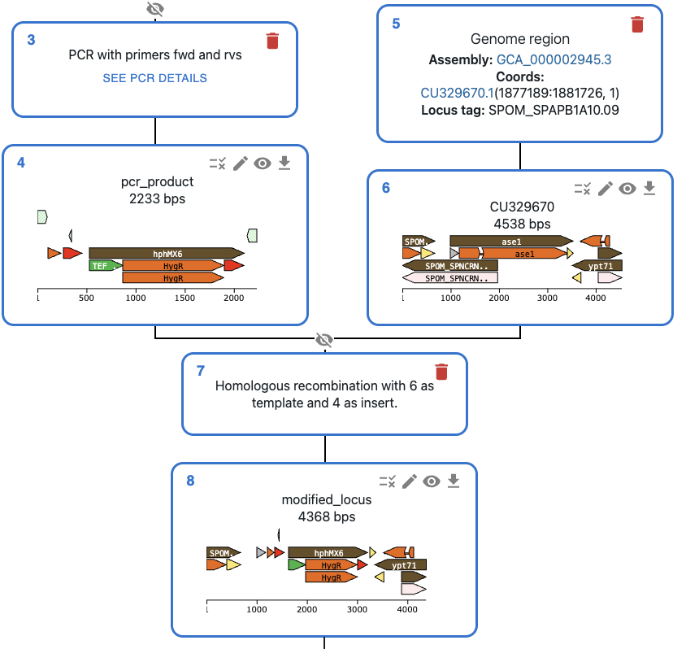
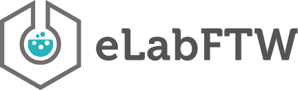
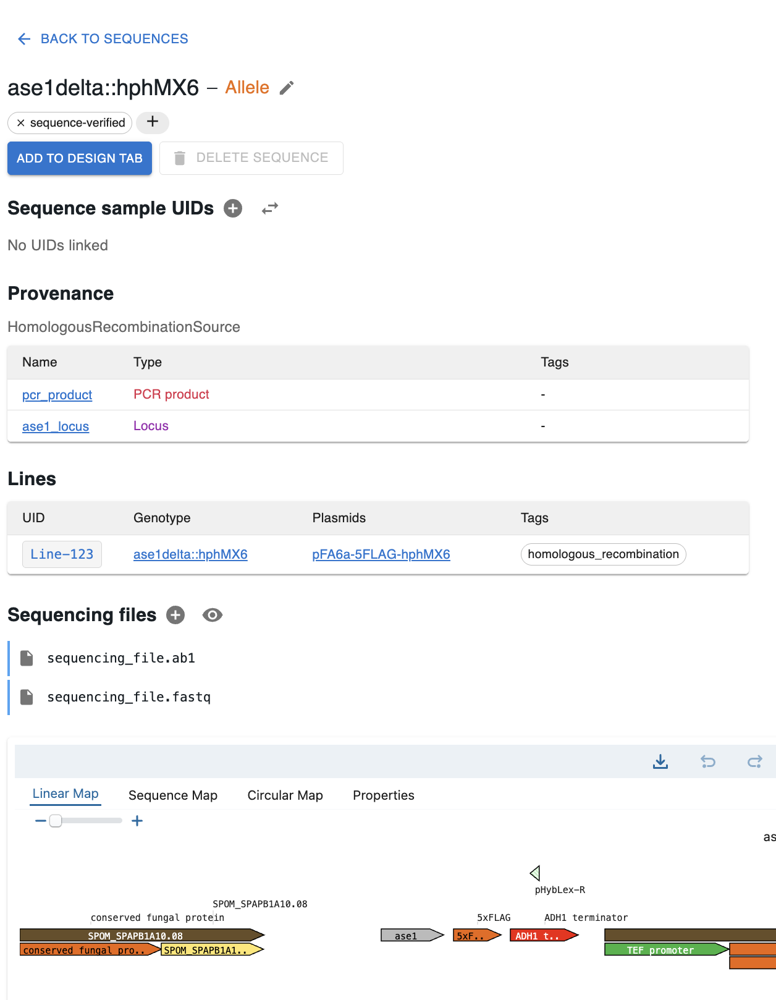

<div class="box full">

# 🧬 What is OpenCloning?

<div class="content">

An **open-source platform to plan, document and automate DNA engineering**.

* **Design in the browser or script it in Python**.
* **Every step is recorded** in an open data model: every construct is traceable and reproducible.
* **Download entire workflow** as JSON.
* **Free online**, and can be **self-hosted**.

<div class="img-wrapper">
    
</div>

<div class="mt-2 img-wrapper alert alert-info" role="alert" style="display: flex; justify-content: center; align-items: center; border-radius: 1em;">
  <div>Use it at <a href="https://app.opencloning.org">https://app.opencloning.org</a></div>
  
</div>

</div>
</div>

<div class="box full col-start">

# 🤖 Automate it end-to-end

<div class="content">

* Built on **pydna**: every method available in **Python**.
* Automate your design with scripts, and turn them into **reusable robotic workflows** for lab automation.

```python
product, *_ = golden_gate_assembly(
[insert1, insert2, vector], [BsaI])
print(product.history())

╙── product (Dseqrecord(o39))
    └─╼ RestrictionAndLigationSource
        ├─╼ insert1 (Dseqrecord(-27))
        ├─╼ insert2 (Dseqrecord(-27))
        └─╼ vector (Dseqrecord(o35))
```

<div class="mt-2 img-wrapper alert alert-info" role="alert" style="display: flex; justify-content: center; align-items: center; border-radius: 1em;">
  <div>See an example Python notebook</div>
  
</div>

</div>
</div>


<div class="box full">

# 🔌 Integrates with your lab software

<div class="content">

* API enables **easy integration** with ELNs, LIMS and lab equipment.
* Already integrated with **eLabFTW**.

<div class="img-wrapper">
    
</div>

</div>
</div>

<div class="box full col-start">

# 🗄️ OpenCloningDB

<div class="content">

## Go beyond cloning and manage your collection

* **Sequences, oligos, strains and sequencing data** in one database, connected by provenance.
* **We can host it for your lab**, or you can **self-host it**: it's open source.

<div class="img-wrapper">
    
</div>

<div class="cta">
  <div class="cta-title">Try OpenCloningDB in your lab</div>
  <div class="cta-body">
    <div>
      <div>We'll help you set it up. Your feedback shapes what we build next.</div>
      <div class="cta-email">✉️ <a href="mailto:manulera14@gmail.com?subject=OpenCloningDB">manulera14@gmail.com</a></div>
    </div>
    
  </div>
</div>

</div>
</div>
