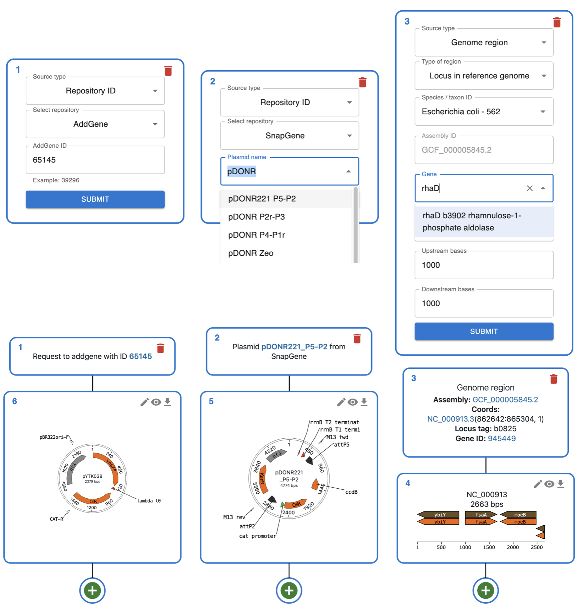
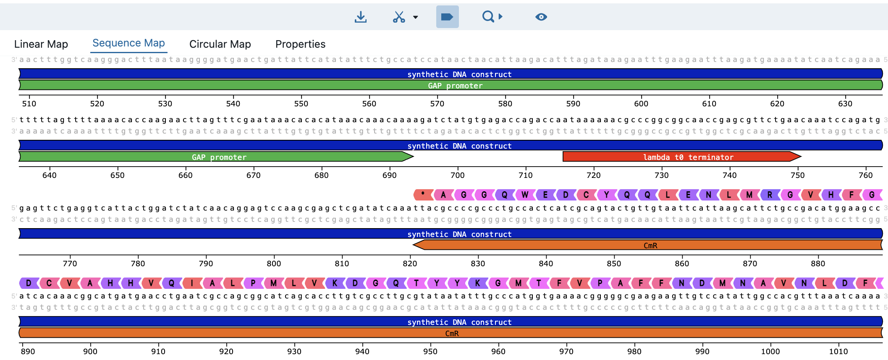
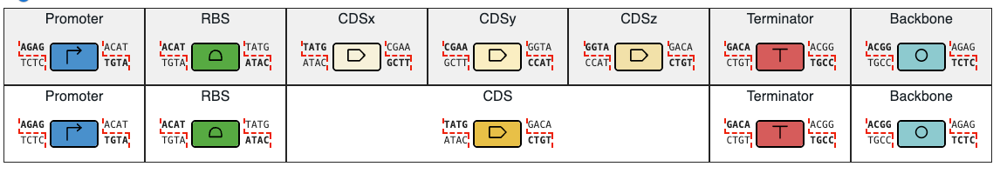
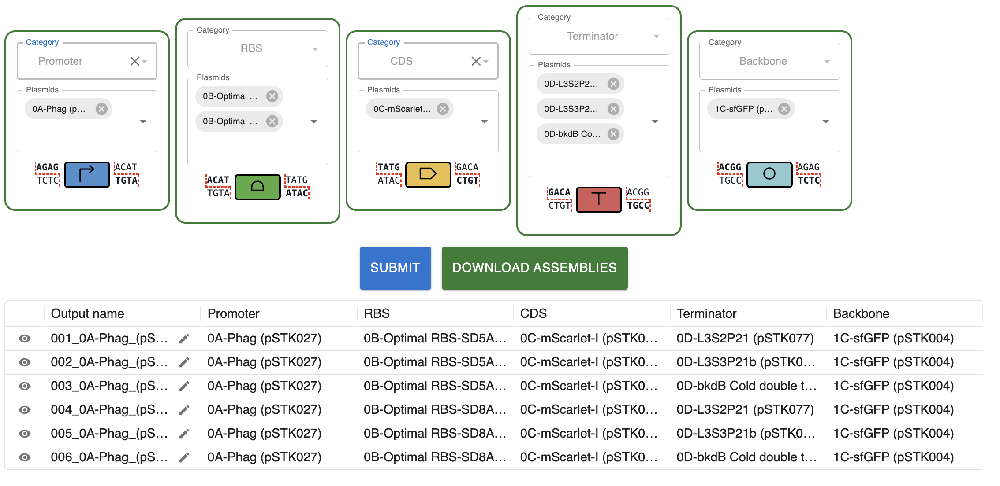
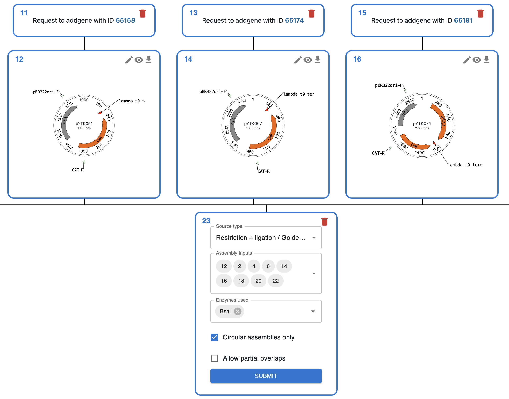
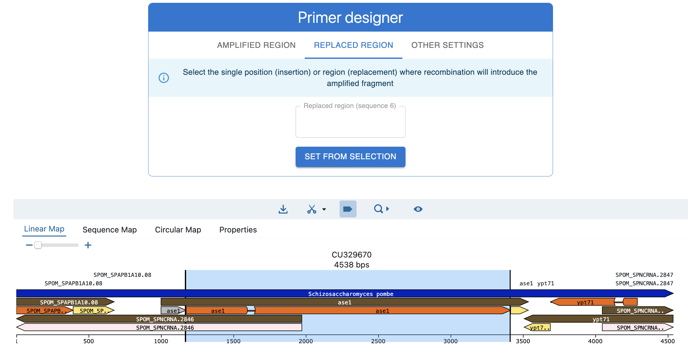

# ⬇️ Import from anywhere ⬇️

<ul style="list-style-type: none;padding-left: 0px;">
<li>💻 Local files</li>
<li>🔄 AddGene</li>
<li>💰 GenBank</li>
<li>🧬 NCBI genomes</li>
<li>🧪 SnapGene website</li>
<li>🪼 Benchling link</li>
<li>🇪🇺 EuroScarf</li>
<li>📓 ELNs</li>
</ul>

    

# 👁️ Rich feature viewer 👁️

    

# 🥇 Best Golden Gate tool 🥇

* **Faster and simpler than Benchling and SnapGene.**
* **Define your assembly syntax once** (the overhangs of each part type).
* **Plasmids are sorted automatically** into the right category (promoter, CDS, terminator...).
* **Pick parts from dropdowns** and get every combination, fully documented.
* **Automatic domestication** coming soon.

    

    

  
Create your own syntax at <u>https://syntax.opencloning.org/</u>

  

# 🧬 Techniques supported 🧬

<ul style="list-style-type: none;padding-left: 0px;">
<li>🌉 Golden Gate</li>
<li>🧩 Gibson Assembly</li>
<li>✂️ Restriction - ligation</li>
<li>🧪 PCR</li>
<li>🔀 Hom. Recombination</li>
<li>🦠 CRISPR-HDR</li>
<li>🔄 Overlap extension PCR</li>
<li>⛩️ Gateway™</li>
<li>➡️ Polymerase extension</li>
<li>🧬 Oligo hybridization</li>
<li>🧫 <i>In vivo</i> assembly</li>
<li>🐁 Cre-loxP</li>
<li>🧬 Recombinases</li>
</ul>

    

# 🧪 Primer design 🧪

<ul style="list-style-type: none;padding-left: 0px;">
<li>🧩 Gibson Assembly</li>
<li>🔀 Hom. Recombination</li>
<li>🦠 CRISPR-HDR</li>
<li>✂️ Restriction - ligation</li>
<li>🔄 Checking PCR</li>
<li>⛩️ Gateway™</li>
</ul>

    

